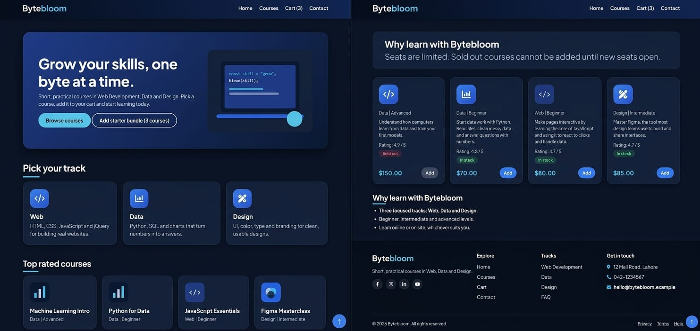
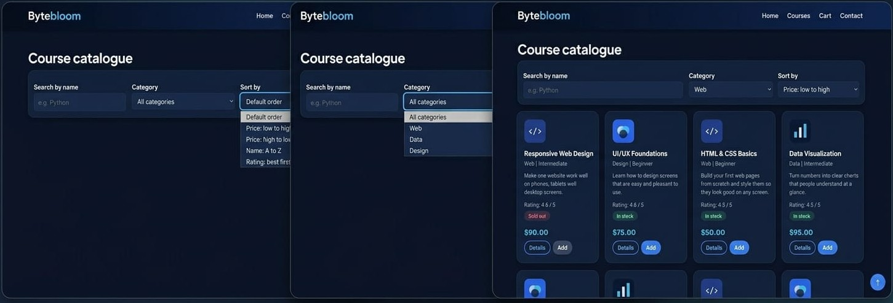
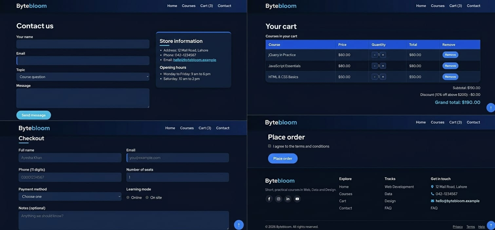

# Bytebloom

A front-end course catalogue store where visitors can browse, search, filter and sort courses, add courses to a cart, see totals update instantly, and complete a checkout form.

## Project Details

- **Theme:** Course Catalogue (Web, Data and Design courses)
- **Course:** Web Engineering — Assignment No. 2
- **Technologies:** HTML5, CSS3, JavaScript (ES6), jQuery 3.7.1
- **Design:** Dark blue theme with cyan accents
- **Project type:** Individual project
- **Student:** Bakhtawar Ahmad
- **Backend:** Not required for this assignment


**GitHub repository:** [Bytebloom](https://github.com/Bakhtawar172/Bytebloom)

## Pages

| Page | File | Description |
|---|---|---|
| Home | `index.html` | Hero section, featured content, starter bundle and FAQ |
| Courses | `courses.html` | Course listing, search, category filter, sorting and course details |
| Cart and Checkout | `cart.html` | Cart items, quantity controls, subtotal, discount, total and checkout form |
| Contact | `contact.html` | Contact form and store information |

All pages share a common navigation bar and styling.

## Features

### HTML
- Four linked pages with semantic HTML structure.
- Forms with appropriate input types and HTML5 validation.
- Images with alternative text, lists and a cart table.

### CSS
- Shared external stylesheet: `css/style.css`.
- Dark blue and cyan colour palette.
- Flexbox and CSS Grid layouts.
- Responsive layouts using media queries.
- Hover and focus states for interactive elements.

### JavaScript
- Course data stored as an array of objects.
- Dynamic course cards.
- Search, category filtering and sorting.
- Course details lookup.
- Add, remove and change cart quantities.
- Subtotal, discount and grand-total calculations.
- Checkout form validation with error messages.
- Cart saved in `localStorage`.

### jQuery
- jQuery 3.7.1 loaded from a CDN.
- Event handling and page interactions.
- Effects such as fading and sliding.
- AJAX loading of course data from `products.json`, including loading/error handling and fallback data.
- Method chaining.

## Folder Structure

```text
bytebloom/
├── index.html
├── courses.html
├── cart.html
├── contact.html
├── products.json
├── css/
│   └── style.css
├── js/
│   ├── data.js
│   ├── store.js
│   └── ui.js
├── images/
│   ├── data.svg
│   ├── design.svg
│   ├── hero.svg
│   └── web.svg
└── README.md
```

## How to Run

1. Open the `bytebloom` folder in Visual Studio Code.
2. Install the **Live Server** extension if it is not already installed.
3. Right-click `index.html`.
4. Select **Open with Live Server**.

Use Live Server rather than opening `index.html` directly, because the browser may block AJAX requests to `products.json` when using local files.

## How to Test

- Visit all four pages using the navigation bar.
- Search for a course and try the category filters.
- Test each sorting option.
- Add courses to the cart, change quantities and remove items.
- Check that subtotal, discount and total update correctly.
- Submit the checkout form with missing or invalid information.
- Refresh the page to check whether the cart remains saved.
- Test the layout at desktop and phone-sized widths.
- Open the browser console and check for errors.


## Screenshots

### Home Page


### Courses Page


### Cart and Checkout



## Notes

- This is a front-end project and does not use a back-end server.
- Course details and contact information are sample data for the assignment.
